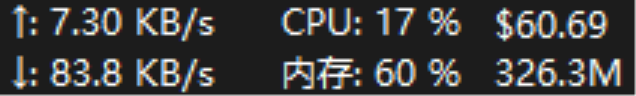

[English](README_EN.md) | **中文**

# CCSwitch Usage · TrafficMonitor 任务栏插件

在 Windows 任务栏上实时显示 [cc-switch](https://github.com/farion1231/cc-switch) 的用量统计。第一行是今日消耗金额，第二行是今日消耗 tokens，鼠标悬停可查看近 7 天 / 30 天汇总。



## 显示内容

| 位置 | 内容 | 示例 |
|---|---|---|
| 第一行 | 今日消耗金额 | `$60.69` |
| 第二行 | 今日真实消耗 tokens（与 cc-switch 口径一致） | `175.6M` |
| 鼠标悬停 | 今日 / 近 7 天 / 近 30 天汇总 | — |

数据每 5 秒自动刷新。

## 环境要求

- Windows 10 / 11
- [TrafficMonitor](https://github.com/zhongyang219/TrafficMonitor) V1.86 及以上
- 已安装并使用 [cc-switch](https://github.com/farion1231/cc-switch)

## 安装

1. 下载 [bin/CCSwitchUsage.dll](bin/CCSwitchUsage.dll)
2. 复制到 TrafficMonitor 的 `plugins` 目录，例如：
   ```
   C:\Program Files\TrafficMonitor\plugins\CCSwitchUsage.dll
   ```
3. 重启 TrafficMonitor
4. 在任务栏的 TrafficMonitor 上右键 → 显示设置，勾选 **CC用量**

## 从源码构建

依赖 MinGW-w64（`g++`）和 curl：

```bat
cd script
build.bat
```

脚本会自动下载 SQLite amalgamation 并编译，产物输出到 `bin/CCSwitchUsage.dll`。

## 工作原理

插件以**只读**方式打开 cc-switch 的本地数据库 `%USERPROFILE%\.cc-switch\cc-switch.db`：

- 按本地时区取今日零点 / 7 天前 / 30 天前零点为界聚合 `proxy_request_logs` 表
- 真实消耗 tokens = 新输入 + 输出 + 缓存创建 + 缓存读取
- 对 Codex / Gemini / GrokBuild 的 `input_tokens` 先做缓存归一化，避免缓存被重复计算
- 金额使用 cc-switch 记录的 `total_cost_usd`（与其内部计价一致）
- SQLite 只读打开 + 3 秒忙等待，与 cc-switch 的写入互不干扰

不后台常驻、不上传任何数据、不修改 cc-switch 的任何文件。

## 致谢

- [TrafficMonitor](https://github.com/zhongyang219/TrafficMonitor)（zhongyang219）—— 任务栏监控框架
- [cc-switch](https://github.com/farion1231/cc-switch) —— Claude Code / Codex 供应商切换与用量统计

## 许可证

采用与 TrafficMonitor 相同的 [Anti 996 License](LICENSE)。`src/PluginInterface.h` 版权归 zhongyang219 所有。
