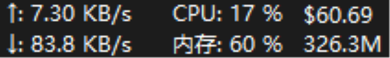

**English** | [中文](README.md)

# CCSwitch Usage · TrafficMonitor Taskbar Plugin

Displays [cc-switch](https://github.com/farion1231/cc-switch) usage stats live on the Windows taskbar. Line 1 shows today's cost, line 2 shows today's tokens; hover for 7-day / 30-day summaries.



## What it shows

| Position | Content | Example |
|---|---|---|
| Line 1 | Today's cost | `$60.69` |
| Line 2 | Today's real consumed tokens (same metric as cc-switch) | `175.6M` |
| Hover | Today / last 7 days / last 30 days summary | — |

Data refreshes every 5 seconds.

## Requirements

- Windows 10 / 11
- [TrafficMonitor](https://github.com/zhongyang219/TrafficMonitor) V1.86 or later
- [cc-switch](https://github.com/farion1231/cc-switch) installed and in use

## Install

1. Download [bin/CCSwitchUsage.dll](bin/CCSwitchUsage.dll)
2. Copy it to TrafficMonitor's `plugins` directory, e.g.:
   ```
   C:\Program Files\TrafficMonitor\plugins\CCSwitchUsage.dll
   ```
3. Restart TrafficMonitor
4. Right-click TrafficMonitor on the taskbar → Display Settings, check **CC用量**

## Build from source

Requires MinGW-w64 (`g++`) and curl:

```bat
cd script
build.bat
```

The script downloads the SQLite amalgamation automatically and outputs `bin/CCSwitchUsage.dll`.

## How it works

The plugin opens cc-switch's local database `%USERPROFILE%\.cc-switch\cc-switch.db` in **read-only** mode:

- Aggregates the `proxy_request_logs` table from today's midnight / 7 days ago / 30 days ago (local timezone)
- Real consumed tokens = fresh input + output + cache creation + cache read
- Normalizes cache-inclusive `input_tokens` for Codex / Gemini / GrokBuild to avoid double-counting cache
- Cost comes from cc-switch's `total_cost_usd` (identical to its internal pricing)
- SQLite is opened read-only with a 3-second busy timeout, so it never interferes with cc-switch

No background daemon, no data upload, no modification of cc-switch files.

## Credits

- [TrafficMonitor](https://github.com/zhongyang219/TrafficMonitor) by zhongyang219 — the taskbar monitor framework
- [cc-switch](https://github.com/farion1231/cc-switch) — Claude Code / Codex provider switcher & usage tracker

## License

Released under the [Anti 996 License](LICENSE), the same as TrafficMonitor. `src/PluginInterface.h` is copyright zhongyang219.
